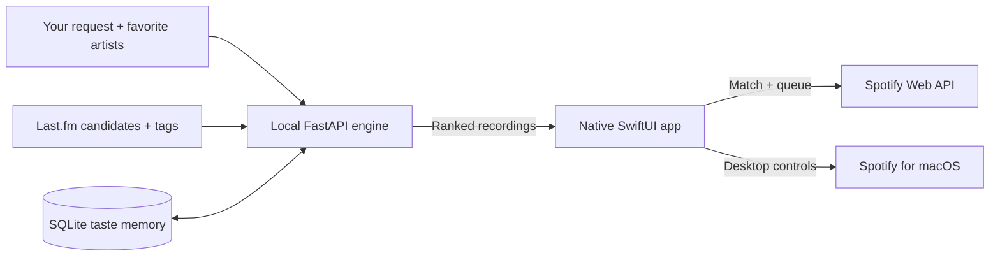

<p align="center">
  
</p>

<h1 align="center">Mochi</h1>

<p align="center">A little desktop companion for music discovery and Spotify playback.</p>

<p align="center">
  <a href="#demo">Demo</a> ·
  <a href="#get-started">Get started</a> ·
  <a href="#how-it-works">How it works</a> ·
  <a href="docs/PRIVATE_BETA.md">Beta guide</a> ·
  <a href="SPEC.md">Specification</a>
</p>

Describe what you want to hear, choose how familiar or adventurous the session should be, and let Mochi find the next song. A small animated character lives on your desktop; playback controls stay in the menu bar.

> **Private beta.** The native app, discovery engine and continuous queue system are implemented. Automated checks and live Last.fm discovery have passed; real Spotify playback and queue behavior still need verification. See the [release report](docs/private-beta-validation.md).

## Demo

<p align="center">
  <a href="design/demo/mochi-demo.gif">
    
  </a>
</p>

Native SwiftUI preview with fictional tracks and simulated playback. [Still preview](design/demo/mochi-demo.png) · [Recreate the demo](design/demo/README.md)

## Features

- **A desktop companion.** Drag Mochi anywhere, click to open a compact Liquid Glass card, and watch it squish, wave, dance and fall asleep. Supports Reduce Motion and Reduce Transparency.
- **Discovery shaped by your taste.** Choose up to three favorite artists and switch between Familiar, Balanced and Discover. Last.fm supplies real candidates; Mochi ranks them against your request and saved feedback.
- **Continuous listening.** API-connected sessions queue confirmed Spotify matches and find more as the queue runs low. **Up Next** shows the current song and acknowledged upcoming tracks across batches.
- **Feedback with context.** Like, dislike, read **Why this song**, or choose **More like this** from a song's menu. Replay one of twelve recent sessions with fresh picks and your current favorite artists.
- **A compact player.** Artwork, Now Playing and essential transport controls live in the menu bar. Search Spotify directly, retry an unresolved recording, or play a copied track link through desktop controls.
- **Built to run locally.** The bundled app manages its own music engine and semantic model. Native settings handle setup, engine status and Keychain configuration.

## How it works



Mochi interprets explicit requirements, gathers candidates, ranks them to prioritize song-detail lookups, then reranks using the new tags and your taste. A local text embedding model measures relevance, with lexical matching as a fallback. Likes, artist preferences and repetition penalties adjust the ordering.

The native app resolves recordings on Spotify using artist, title, version and available recording identifiers. It skips uncertain matches and supports partial results. Spotify metadata stays in the native client; the recommendation model uses independently sourced Last.fm text. See [discovery and ranking](docs/music-discovery.md) for the full design and tradeoffs.

| Layer | Technology |
|---|---|
| Native app | Swift, SwiftUI, AppKit, Liquid Glass |
| Local API | Python, FastAPI, Pydantic, HTTPX |
| Ranking | FastEmbed, ONNX Runtime, BGE text embeddings; lexical fallback |
| Persistence | SQLite, UserDefaults, macOS Keychain |
| Music integration | Last.fm discovery, Spotify Web API, local Apple Events |
| Tooling | Xcode, uv, PyInstaller, GitHub Actions |

## Get started

Mochi requires **macOS 26 or later**, Spotify, and a [Last.fm API key](https://www.last.fm/api/account/create) for live discovery. Source development also requires Xcode and [uv](https://docs.astral.sh/uv/); the backend uses Python 3.12 or later.

### Bundled beta

The beta includes Python, the music engine and the pinned semantic model. Use a build matching your Mac's architecture; `arm64` is for Apple Silicon.

1. Copy `Mochi.app` to Applications and open it.
2. Open the music-note menu, then **… → Setup & Settings**. Save your Last.fm API key; the bundled engine starts automatically.
3. Open Spotify, choose a playback route as described below, then click Mochi to choose favorite artists or skip setup.
4. Try a request such as **jazz piano**, **indie rock**, or **mellow acoustic guitar**.

The current build is ad-hoc signed. Installation details, permissions and troubleshooting are in the [beta guide](docs/PRIVATE_BETA.md).

### From source

Run these commands from the repository root:

```bash
bash scripts/setup.sh
```

This installs locked dependencies, prepares the pinned semantic model, and creates `backend/.env` if needed. Add your key locally:

```dotenv
LASTFM_API_KEY=your_key_here
```

Then start the engine:

```bash
bash scripts/run-mochi.sh
```

Leave that terminal running. Open `Mochi/Mochi.xcodeproj`, select **Mochi → My Mac**, and press **Command-R**. Click the menu-bar music note for playback controls or the floating character for a listening request.

The engine listens at `127.0.0.1:8000`. Open the [API explorer](http://127.0.0.1:8000/docs) or [health check](http://127.0.0.1:8000/health) while it runs. **Control-C** stops the engine started by the script; an existing compatible backend is reused. Restart after changing `.env`.

For reload-on-save development, use `uv run --extra semantic fastapi dev main.py` from `backend/` instead. VS Code works for editing; Xcode handles the native build, signing and debugger. More detail is in the [backend walkthrough](docs/backend.md).

## Spotify setup

| Route | What it supports | Setup |
|---|---|---|
| **Desktop controls** | Now Playing, play/pause, skips and one copied track link; public search handoff for recommendations | Open Spotify, choose **Use desktop controls** in the player settings, and grant macOS Automation permission. |
| **Optional Web API** | Automatic catalog matching, direct search and continuous queue appends | Connect an invited Spotify Premium account and start Spotify on the desired device. |

Desktop controls work without Spotify API login. Automatic matching and continuous queues require API access, including when desktop controls are selected. Without it, use a recommendation's **Find on Spotify** action and paste the chosen track link into the player's **Spotify track link** field.

For a source build using your own Spotify developer app, set its public Client ID in [SpotifyAuthorization.swift](Mochi/Mochi/SpotifyAuthorization.swift) and register this redirect URI:

```text
http://127.0.0.1:8888/callback
```

Authentication uses Authorization Code with PKCE, automatic token refresh and Keychain storage. See [authentication](docs/spotify-auth.md) and [desktop playback](docs/local-spotify-playback.md) for setup and implementation details.

## Build a beta

After source setup:

```bash
backend/.venv/bin/python scripts/build-beta.py
```

Outputs appear under `build/beta/`: `Mochi.app`, an architecture-specific zip, dependency notices and a fixture validation report. Packaging includes the pinned model, checks that semantic ranking works, and excludes credentials, provider caches and personal databases. Bundled builds use the Last.fm key saved in native Settings; an external development backend keeps its own `.env` configuration.

## Verification

| Command | Coverage |
|---|---|
| `bash scripts/check.sh --ui` | Backend, auth, matching, playback, queue sessions, engine, native panels and an Xcode build |
| `bash scripts/test-backend.sh --python-only` | Fast backend and ranking checks with deterministic or injected model outputs |
| `bash scripts/test-backend.sh --semantic` | Prepared-model retrieval checks and the small held-out intent evaluation |
| `MOCHI_ENGINE_SANDBOX=1 bash scripts/test-engine.sh` | Signed parent/child engine startup and shutdown; build the bundled engine first |

Default checks use simulated providers, fake credentials and disposable data. They do not establish real-account playback or recommendation quality. Backend checks also run through [GitHub Actions](.github/workflows/checks.yml). The [release report](docs/private-beta-validation.md) records completed checks and remaining live tests; [the discovery guide](docs/music-discovery.md) covers separate live probes and relevance evaluation.

## Data and privacy

- **Credentials:** Spotify tokens and the bundled app's Last.fm key live in macOS Keychain. Development keys stay in the ignored `backend/.env`.
- **Local memory:** favorite artists, recent requests and window preferences use UserDefaults; explicit feedback and recommendation context use SQLite. Replaceable provider caches are bounded and kept separate from taste memory.
- **Provider boundaries:** Last.fm receives discovery lookups; Spotify receives matching and playback requests. Spotify payloads do not enter the recommendation model. The app has no cloud account service or background telemetry.
- **Your controls:** clear recent sessions independently, or use **Forget taste memory** to remove backend feedback/context and then native artist choices and recent requests. Mochi stops only the backend process it owns.

## Current limits

- **Distribution:** this is a private development beta. API matching and queues depend on Spotify's development allowlist. Public distribution requires Developer ID signing/notarization and provider review; desktop controls do not broaden API access.
- **Music coverage:** Last.fm discovery reaches beyond cached songs, but cannot guarantee every Spotify recording, new release or a confident recording match.
- **Musical measurements:** BPM, vocals and energy can be unknown. Unknown values fail strict requirements, and requested BPM ranges are never widened silently. Experimental ReccoBeats tempo enrichment is off by default.
- **Session ownership:** pause suspends refills; unrelated playback or a device change ends the managed session. **Stop continuous listening** stops future refills while leaving already queued Spotify songs in place.

## Project guide

```text
Mochi/       Native Xcode project, SwiftUI views, authentication and playback
backend/     Local API, discovery providers, ranking and SQLite storage
Tests/       Backend, native model and interface checks
scripts/     Setup, development, verification and beta packaging
design/      Mascot artwork, app icon and design references
docs/        Architecture, walkthroughs and validation reports
```

| Guide | Contents |
|---|---|
| [Specification](SPEC.md) | Product scope, current decisions and implementation boundaries |
| [Discovery and taste](docs/music-discovery.md) | Candidate sources, two-pass ranking, feedback and constraints |
| [Intent understanding](docs/intent-understanding.md) | Explicit parsing, semantic interpretation and measured results |
| [Backend](docs/backend.md) | API contracts, configuration and request flow |
| [Companion motion](docs/compact-companion-motion.md) | Character reactions, native panels and accessibility |
| [Private beta](docs/PRIVATE_BETA.md) | Installation, daily use and troubleshooting |
| [Third-party notices](docs/THIRD_PARTY.md) | Model, dependencies and provider references |
